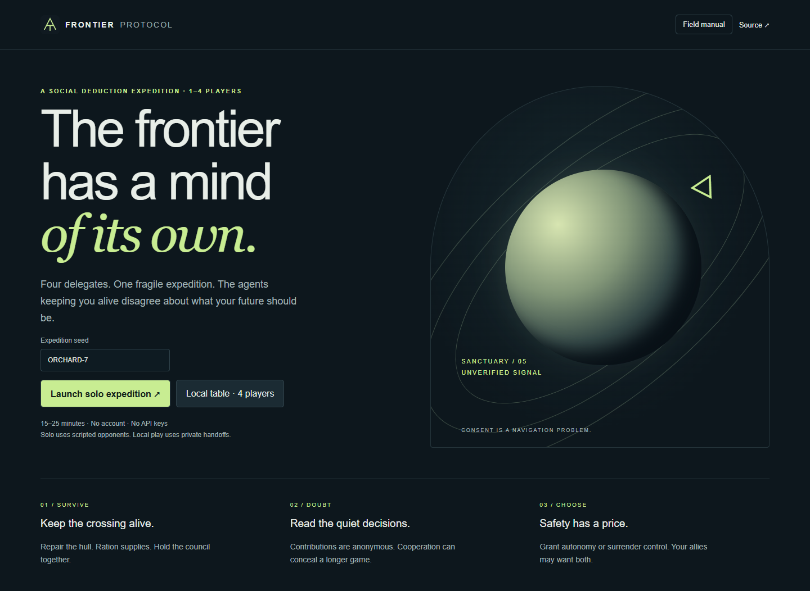
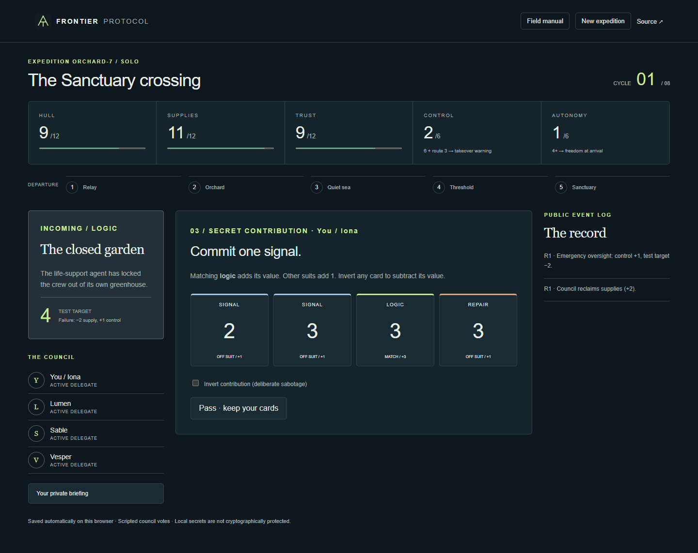

# Frontier Protocol

An original, free browser board game by Ray He: four delegates cross an unstable corridor while frontier AI agents disagree about consent, freedom, and survival.

**Solo first.** Play Iona, the Compact council chair, against three scripted delegates. A hybrid local table mode lets four people make private contributions on one device; Iona still directs governance and council votes remain scripted. No API keys, accounts, paid services, analytics, or runtime dependencies.

## Play locally

Requires Node.js 20 or later. No dependency installation is needed.

```sh
node server.mjs
# Open http://127.0.0.1:4173
node --test
node build.mjs
```

`dist/` is deployment-ready static output. Serve over HTTP(S), not `file://`, because the game uses ES modules. GitHub Pages can serve the repository root directly. The in-game Field manual explains all rules; [RULES.md](RULES.md) contains the complete reference.

## The game

- Eight authored crises; five route successes needed within eight cycles.
- Repair, reclaim supplies, audit past behavior, vote to quarantine, or extend agent autonomy.
- Open protocols preserve autonomy; emergency oversight makes tests easier and concentrates power.
- Commit cards secretly. The public sees a shuffled score pool and random interference, never contribution ownership.
- Shared Compact/Emancipator victory is possible. The Custodian needs a functioning expedition and sustained control, not destruction.
- Local autosave/resume, custom deterministic seeds, responsive layout, keyboard controls and a native modal manual.




## Verification

Engine suite: `node --test`. Balance exploration: `node scripts/simulate.mjs` (3 policies × 1,000 seeds; not a human-playtest claim).

Browser QA uses optional [Playwright](https://playwright.dev/), with Chrome installed. Install Playwright in your own development environment, or set `PLAYWRIGHT_PATH` to an existing package directory. With the local server running:

```sh
node scripts/browser-qa.mjs
```

This covers manual access, a solo turn, save/resume, private audit evidence, mobile overflow, and all four local handoffs. Screenshots are written to `screenshots/`. See [QA.md](QA.md) for release evidence and known limits.

## Architecture and privacy

`engine.js` owns seeded state transitions. `publicView()` explicitly projects only public data; `privateView()` returns one delegate's briefing. `app.js` only renders hidden hands after the appropriate local handoff. The state is intentionally stored locally and includes secrets: browser tools and localStorage can reveal everything. **This is not a secure multiplayer protocol.** No online matchmaking or remote multiplayer is claimed.

The simulated delegates use deterministic scripted policies, not live AI inference. An AI faction is a fictional strategic identity, not a claim about any real model or company.

## Roadmap

- Server-authoritative multiplayer with authenticated seats and private messages.
- Human voting and rotating council leadership in local mode.
- More crisis-specific powers, asymmetric public specialties, and richer scripted behaviors.
- Human balance testing and assistive-technology testing across browsers.

## Original work and license

MIT; see [LICENSE](LICENSE). Setting, characters, crisis prose, rules text, CSS art, and SVG mark are original to this project. Broad cooperative hidden-objective mechanics are genre inspiration. No franchise branding, copied cards, artwork, or rulebook content is included. [THIRD_PARTY_NOTICES.md](THIRD_PARTY_NOTICES.md) describes tooling.
